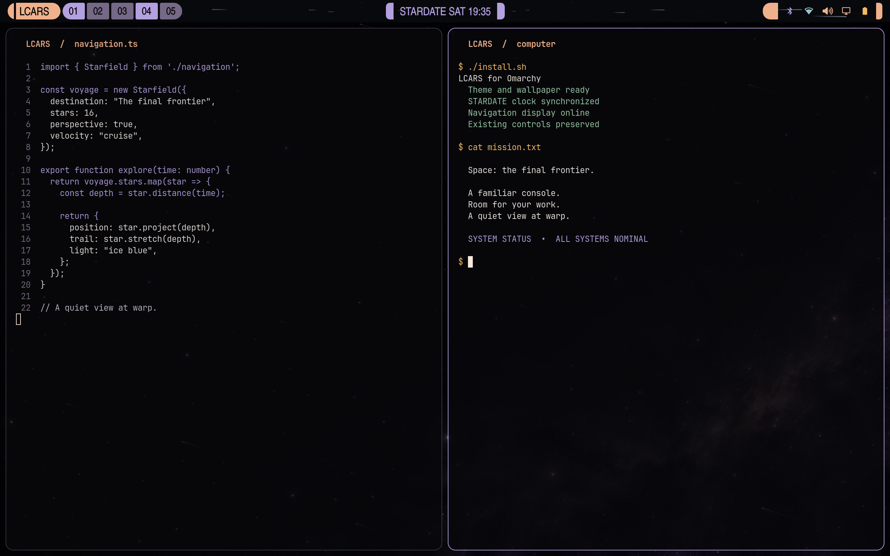
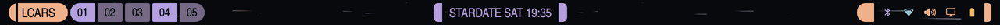

# LCARS for Omarchy

**A quiet view at warp.**

A complete Star Trek–inspired desktop for Omarchy: peach and lavender panels,
readable dark terminals, and a starfield that travels
outward behind the entire bar. The stars begin as distant points and stretch
into icy-white trails as they approach the edges.





## Install the complete experience

Requires **Omarchy 4 / Quattro with the Quickshell shell**, a top or bottom bar,
Python 3.11+, and Git. Tested on `4.0.0.alpha`; this is an early community
release, and future shell API changes may require updates. It does not replace
Waybar on Omarchy 3.

```bash
git clone https://github.com/yzingher/omarchy-lcars-theme.git
cd omarchy-lcars-theme
./install.sh
```

Run as your normal desktop user. The installer applies the theme, replaces
standard bar widgets with styled copies, and adds the full-width warp effect.
**Existing custom widgets, shortcuts, and workspace arrangements stay yours.**
Custom replacements of standard widgets are kept, rather than overridden, so
your bar may differ from the screenshots.

Built-in menu, calendar, workspace switching, network, audio, brightness, and
battery actions remain functional. LCARS adds no network service and no audio.
The clock keeps the label already in your shell configuration.

## Choose your level of immersion

```bash
./install.sh --no-animation       # LCARS panels and colors, without moving stars
./install.sh --no-transparency    # Keep windows and terminals opaque
./install.sh --theme-only         # Palette and wallpaper, without bar changes
```

Flags can be combined on the first install. To change installation options,
uninstall and install again. The installer deliberately refuses to overwrite
an existing managed installation or another plugin using its `lcars.*` names.

Focused windows use 97% opacity; inactive windows use 94%. Terminal backgrounds
use 88% alpha while retaining legible glyphs. The Foot theme hook updates
already-open terminals without closing their sessions. No blur is required.

You can also install this repository through Omarchy's ordinary theme picker
for the palette and wallpaper. **The complete animated bar requires running the
installer above**: a theme URL alone does not install executable widgets.
Older desktop versions have not been verified with this palette-only route.

## Uninstall

From this checkout:

```bash
./install.sh --uninstall
```

This restores replaced components and the previous theme when LCARS is still
active. It preserves unrelated bar edits made after installation. Backups remain
in `~/.local/state/omarchy-lcars/backups/`. Locally edited managed theme/plugin
files are protected: uninstall stops and names the changed path so you can
save your edits first.

The installer writes only user configuration and its own state directory. It
does not modify `/usr/share/omarchy`, replace your lock service, or remove apps.
If application colors do not update live, reopen that application.

## How the warp bar works

The star widget takes zero layout width. It paints into the existing bar
surface behind the controls; colored panels naturally cover the stars as they
pass beneath them. It adds no overlay window and no mouse or keyboard handler.

There are 16 approaching stars and 9 faint distant points. Perspective makes
motion and trail length increase toward the edges, with mostly white and icy
blue light and an occasional warm tail. A 20 fps timer keeps the small bar
animation independent of the monitor's full refresh rate. It pauses when the
widget is invisible or the LCARS palette is inactive.

The shared theme colors style application interiors according to each app's
support. This does not inject fictional title bars into editors or websites.

## Development

```bash
python3 -m unittest discover -s tests -v
```

The tests use temporary directories and never touch your real desktop. They
cover install/uninstall, custom widget preservation, restore of an existing
theme, optional features, conflicts, local edits, symlinks, and rollback.
`--no-apply` installs files without running live theme/shell reload commands.

See [compatibility and attribution](docs/COMPATIBILITY.md) and
[wallpaper provenance](docs/wallpaper-prompt.txt).

## Credits

Built by Yoav (yzingher) with Codex. Adapted widgets come from Omarchy's Quickshell
shell; original copyright and license are retained in
[OMARCHY-LICENSE](docs/OMARCHY-LICENSE). Code is MIT licensed.

The space wallpaper was generated with OpenAI image generation; no television
frame or official promotional artwork is bundled. Unofficial fan project,
inspired by LCARS and Michael Okuda's interface design. Not affiliated with or
endorsed by Star Trek's rights holders or the Omarchy maintainers.
