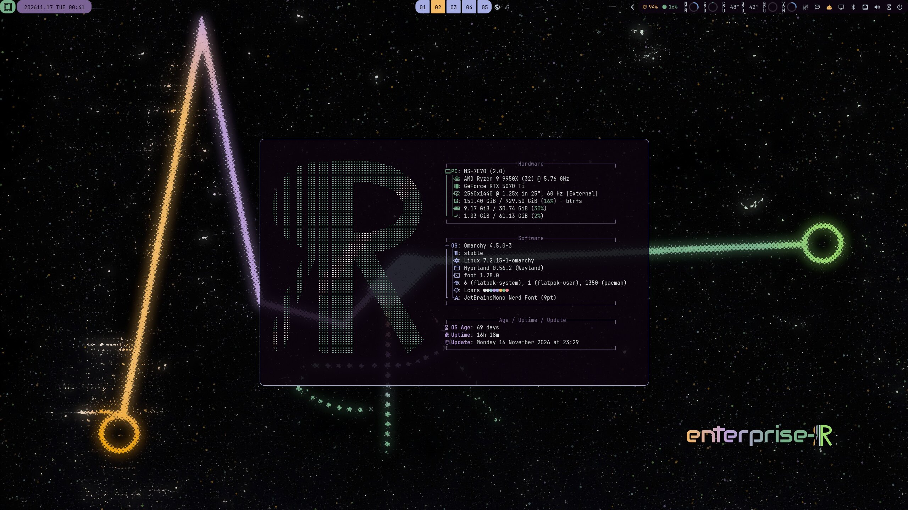
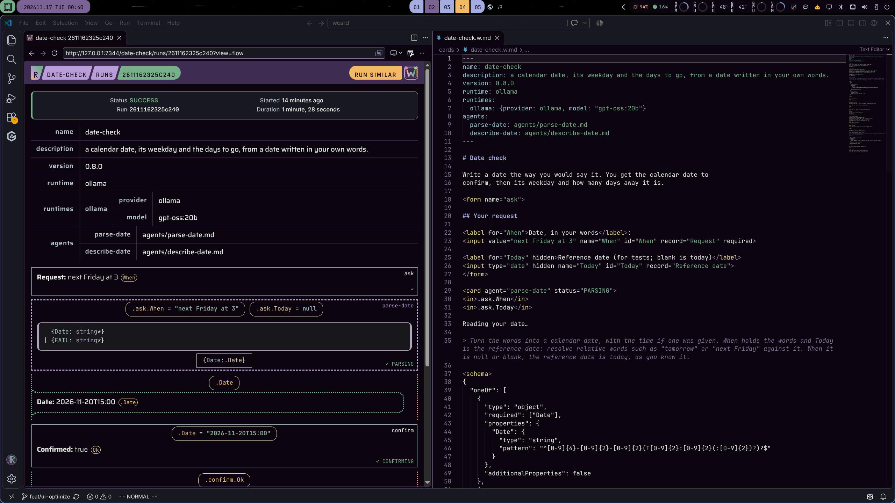
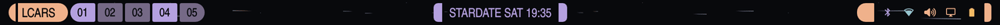
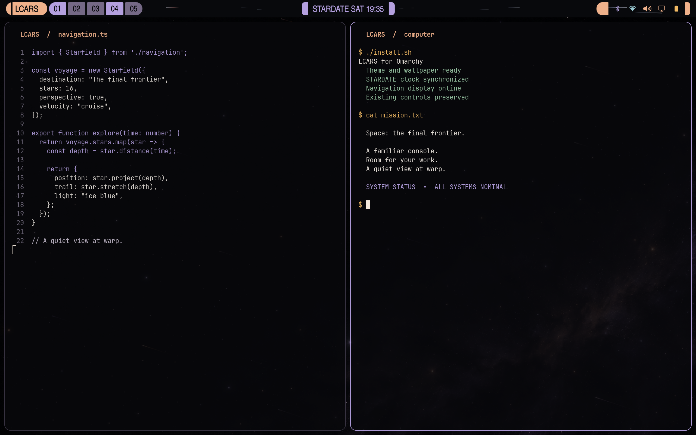
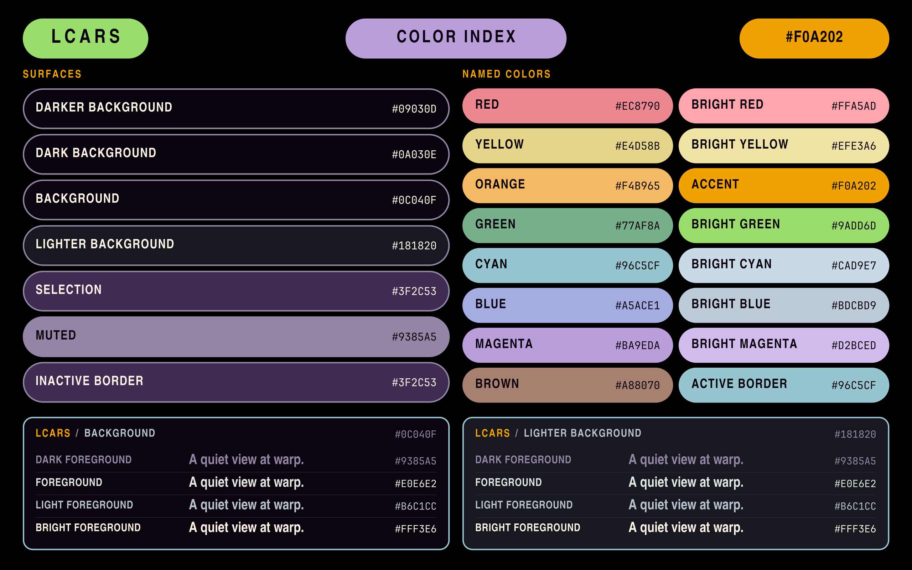

# LCARS for Omarchy

**A quiet view at warp.**

Orange and lavender panels, a dark desk you can read all day, and a starfield
that travels outward behind the bar. Stars begin as distant points and stretch
into icy-white trails as they reach the edges.

## The desk

Wallpaper, bar, and a fastfetch window on Omarchy 4.5. The trails sit behind
the controls. Right-click an empty stretch of the bar to show or hide them.



The same colors in a normal working layout. The browser and VS Code share the
palette. The editor well stays on the deep background. Sidebars, panels, and
the frame use the lighter surface. The active tab is green.



The bar on its own:



Terminals on the wallpaper. The text in this shot is a demo.





## What you get

- Hyprland borders, the warp wallpaper, and the palette in `colors.toml`, which Omarchy turns into terminal, editor, and app colors
- A Quickshell bar with LCARS plates, a centered workspace indicator, and the starfield painted behind the controls
- GTK 3, GTK 4 / libadwaita, Firefox chrome, and a VS Code surface split, written while LCARS is active and cleared when you leave it

Menu, calendar, workspace switching, network, audio, brightness, and battery
keep working. LCARS adds no network service and no audio. The clock keeps the
label already in your shell configuration.

## Install the complete experience

Requires **Omarchy 4 / Quattro with the Quickshell shell**, a top or bottom bar,
Python 3.11+, and Git. The screenshots above are Omarchy 4.5. This is an early
community release, and future shell API changes may require updates. It does
not replace Waybar on Omarchy 3.

```bash
git clone https://github.com/yzingher/omarchy-lcars-theme.git
cd omarchy-lcars-theme
./install.sh
```

Run as your normal desktop user. The installer applies the theme, replaces
standard bar widgets with styled copies, and adds the full-width warp effect.
**Existing custom widgets and shortcuts stay yours.** LCARS puts the calendar
where the workspace indicator was and centers the workspace indicator. A custom
replacement of either widget is left where you put it, so your bar may differ
from the screenshots.

## Choose your level of immersion

```bash
./install.sh --theme-only         # Palette and wallpaper, without bar changes
./install.sh --reinstall          # Refresh an existing install and apply it
```

To switch between the palette-only and complete installs later,
uninstall and install again. `./install.sh --reinstall` copies this checkout
over the managed theme, plugins, and hooks, then applies LCARS again. Your
shell layout and the original options stay in place. Reinstall stops if a
managed file has local edits. The installer still refuses to overwrite another
plugin that uses an `lcars.*` name.

LCARS leaves window and terminal transparency to Omarchy. Turn on Glassy from
the Omarchy menu if you want see-through terminals over the warp wallpaper.

You can also install this repository through Omarchy's ordinary theme picker
for the palette and wallpaper. **The complete animated bar requires running the
installer above**: a theme URL alone does not install executable widgets.
Older desktop versions have not been verified with this palette-only route.

## Uninstall

From this checkout:

```bash
./install.sh --uninstall
```

This restores replaced components and the previous theme when LCARS is still
active. It preserves unrelated bar edits made after installation. Backups remain
in `~/.local/state/omarchy-lcars/backups/`. Locally edited managed theme/plugin
files are protected: uninstall stops and names the changed path so you can
save your edits first.

The installer writes only user configuration and its own state directory. It
does not modify `/usr/share/omarchy`, replace your lock service, or remove apps.
If application colors do not update live, reopen that application.

## How the warp bar works

The star widget takes zero layout width. It paints into the existing bar
surface behind the controls; colored panels naturally cover the stars as they
pass beneath them. It adds no overlay window. The trails start hidden.
Right-click an empty part of the bar to show or hide them. The menu and the
clock keep their own right-click actions.

There are 16 approaching stars and 9 faint distant points. Perspective makes
motion and trail length increase toward the edges, with mostly white and icy
blue light and an occasional warm tail. A 20 fps timer keeps the small bar
animation independent of the monitor's full refresh rate. It runs only while
the trails are shown on a visible bar, and it stops when they are hidden, the
bar is parked off-screen, or the LCARS palette is inactive.

## How applications pick up the colors

The shared theme colors style application interiors according to each app's
support. This does not inject fictional title bars into editors or websites.

GTK apps get theme-set hooks that write LCARS colors while LCARS is active
and clear them when you leave the theme. Other CSS in those files stays.

- GTK3 themes, including Omarchy's Adwaita-dark and Omagtk, compile their
  colors in. The hook writes a managed sheet into `~/.config/gtk-3.0/`, which
  outranks the theme. This also covers Firefox's system colors and the GTK
  file chooser. Relaunch GTK3 apps after a switch.
- GIMP 3 paints its own gray theme over GTK3. The same hook adds a managed
  block of GIMP's theme colors to `~/.config/GIMP/3.*/gimp.css`. Restart
  GIMP after a switch; profiles GIMP creates later get it on the next switch.
- GTK4 / libadwaita apps ignore the gtk-theme setting. The hook writes the
  libadwaita color variables plus a few state rules into `~/.config/gtk-4.0/`.
  Reopen GTK4 apps after a switch if a long-lived daemon does not repaint.

Firefox gets a managed `userChrome.css` in each profile with the same roles:
purple toolbar, card-colored menus, amber hover, green for the chosen item.
Restart Firefox after a theme switch.

Omarchy's generated VS Code theme paints the activity bar, sidebar, editor,
panel, and title bar with one background. A theme-set hook keeps the code well
on the deep background and lifts sidebars, panels, inputs, and the frame onto
the lighter surface. The current tab and the activity icon use green. Amber is
hover only. The hook reloads VS Code, Cursor, and Codium through
`omarchy-theme-set-vscode`. It writes the split only while LCARS is the
active theme.

## Development

```bash
python3 -m unittest discover -s tests -v
python3 scripts/palette.py
```

`scripts/palette.py` redraws `assets/palette.png` from `colors.toml`.
`scripts/gtk3.py` renders the GTK3 sheet from `colors.toml`.
`scripts/gtk4-libadwaita.py` renders the GTK4 / libadwaita palette from
`colors.toml` (also used by the theme-set hook).
`scripts/firefox-chrome.py` does the same for Firefox chrome.
`scripts/vscode-surfaces.py` writes the editor surface split.

The tests use temporary directories and never touch your real desktop. They
cover install/uninstall, custom widget preservation, restore of an existing
theme, optional features, conflicts, local edits, symlinks, GTK3 and GTK4 palette
hooks, and rollback. `--no-apply` installs files without running live
theme/shell reload commands.

See [compatibility and attribution](docs/COMPATIBILITY.md) and
[wallpaper provenance](docs/wallpaper-prompt.txt).

## Credits

Built by Yoav (yzingher) with Codex. Adapted widgets come from Omarchy's Quickshell
shell; original copyright and license are retained in
[OMARCHY-LICENSE](docs/OMARCHY-LICENSE). Code is MIT licensed.

The space wallpaper was generated with OpenAI image generation; no television
frame or official promotional artwork is bundled. Unofficial fan project,
inspired by LCARS and Michael Okuda's interface design. Not affiliated with or
endorsed by Star Trek's rights holders or the Omarchy maintainers.
